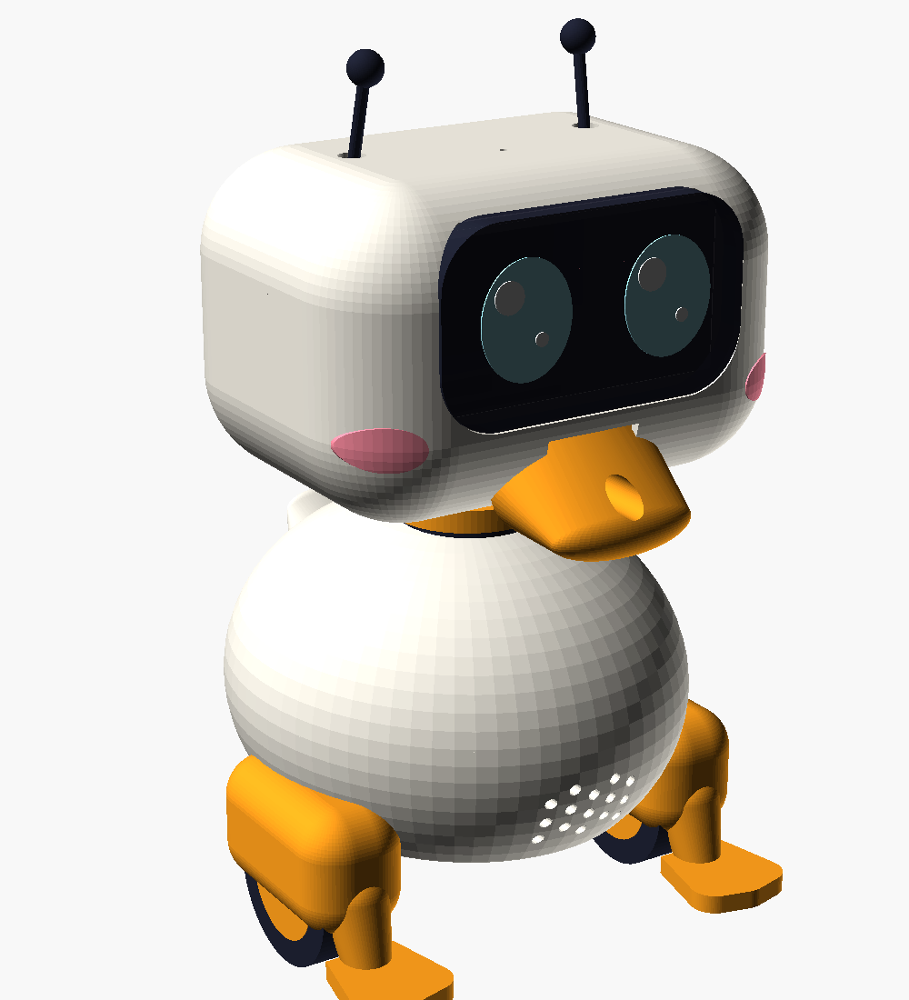
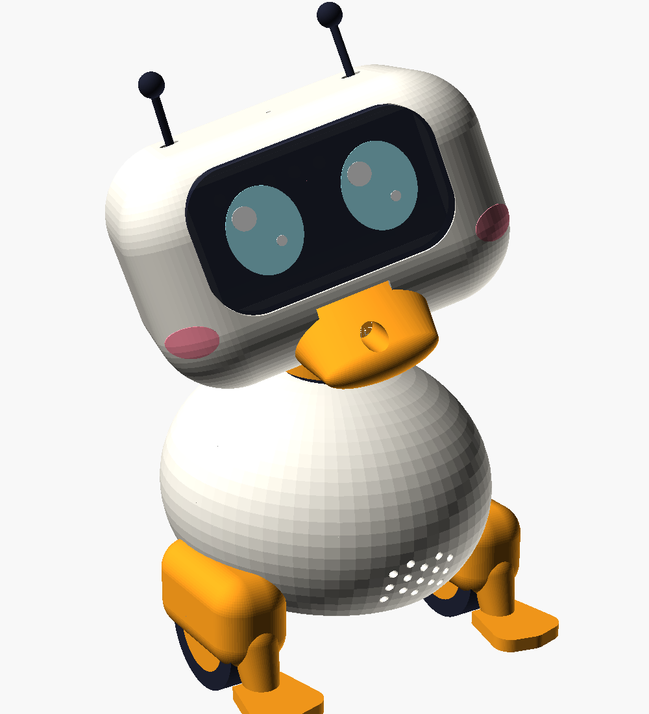
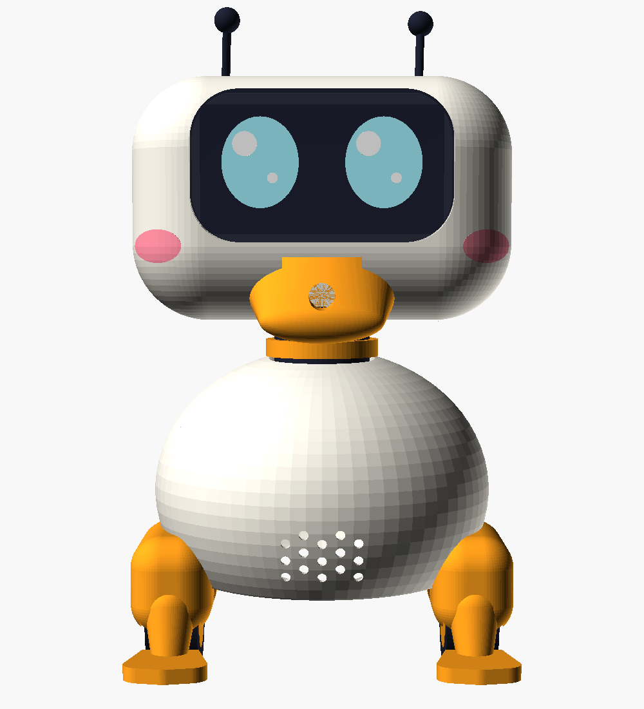
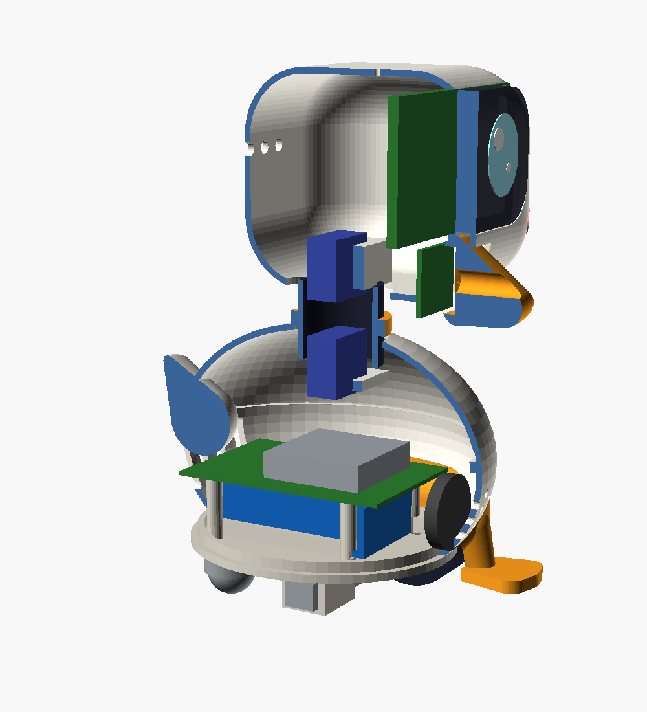
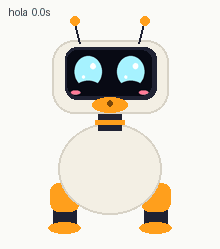
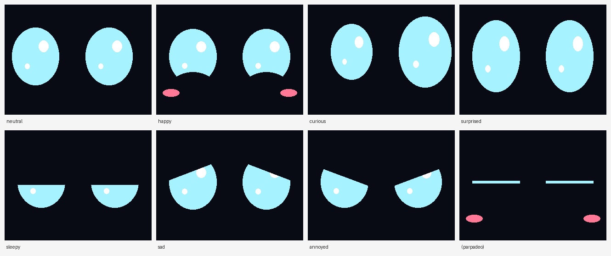

# Pío: micro droide pato con VLM (Raspberry Pi 5)

Pío es un droide de sobremesa de unos 22 cm. Mira con el pico (ahí va la cámara), expresa lo que siente con los ojos de su pantalla, el cuello y las antenas, y entiende lo que ve con un modelo de visión y lenguaje (VLM) que corre **en local** en la Raspberry Pi 5. No usa la nube ni suscripciones.



| ¿Eh? (cuello 3 DOF) | De frente | Por dentro |
|---|---|---|
|  |  |  |

> Estado: **v0.1, prototipo de diseño.** El CAD es paramétrico y las piezas no chocan entre sí, pero todavía no se ha impreso ni montado ninguna. Antes de imprimir todo, imprime de prueba el chasis y la cabeza delantera y comprueba las medidas con tus componentes (sobre todo la pantalla y la bola loca).

---

## 1. ¿Ruedas o patas? Ruedas (por ahora)

El BDX de Disney anda con patas, y es lo que más ganas da de hacer. Con las restricciones de este proyecto (precio y la CPU de la Pi, que ya va justa con la VLM), las ruedas ganan con claridad:

| | **Ruedas (Pío v1)** | Patas bípedas tipo BDX |
|---|---|---|
| Actuadores de locomoción | 2 motores N20, unos 8 € | Unos 10 servos de bus serie (tipo Feetech STS3215), **150-200 €** |
| CPU | Prácticamente nada | Política de control (RL) a ~50 Hz con tiempo real estricto; cuando la VLM mete un pico de latencia, el robot se cae |
| Consumo | 1-2 W | 10-20 W solo en servos, así que hace falta una batería más grande y pesada |
| Desarrollo | Funciona el primer día | Semanas entrenando en simulación (MuJoCo / Isaac) y ajustando sim2real |
| Encima de una mesa | Sensores de borde y a correr | Las caídas son frecuentes; un bípedo de 1 kg con una Pi dentro sufre |

**De dónde sale lo mono:** casi toda la expresividad de un BDX está en la **cabeza**, no en las piernas. Por eso Pío pone el presupuesto ahí: cuello de 3 ejes (giro, asentir y ladear para el gesto "¿eh?"), ojos animados con parpadeo y brillos, antenas con servo y pitiditos de pato. Las ruedas van escondidas en unos "pies" naranjas con dedos palmeados, y esos dedos sirven además de **patines anti-vuelco** si frena en seco (la cabeza pesa).

**Para cuando quieras patas (v3):** la cabeza, la electrónica y el software son modulares. Se puede cambiar el cuerpo con ruedas por un tren inferior bípedo inspirado en el proyecto libre Open Duck Mini y reutilizar todo lo demás. El cerebro "lento" (VLM) y el "rápido" (reflejos) ya están separados precisamente para eso.

---

## 2. Arquitectura: dos cerebros

Una VLM en la CPU de la Pi 5 tarda **segundos** en describir una imagen. Un droide que reacciona con segundos de retraso parece roto, así que Pío tiene dos niveles:

```
            ┌────────────── 20 Hz (1 núcleo) ──────────────┐
cámara ───► │ reflejos: caras (YuNet), bordes, obstáculos   │──► cuello, ruedas, ojos, pitidos
sensores ─► │ máquina de estados + energía (brain.py)       │
            └───────────────▲──────────────────────────────┘
                            │ "veo un gato" → interés 0.9, sorpresa
            ┌───────────────┴── cada ~20 s (3 núcleos) ────┐
            │ VLM local: llama.cpp `llama-server`           │──► diario.jsonl ("lo que Pío vio hoy")
            └───────────────────────────────────────────────┘
```

- **Reflejos** (`pio/brain.py`, `pio/vision.py`): sigue caras con el cuello y, si el cuello llega al tope, gira el cuerpo. Si lo levantas (los dos sensores de borde dejan de ver suelo), se sorprende y mueve las antenas. Si detecta un borde de la mesa, retrocede. Parpadea, mira alrededor a saltitos como un pájaro y se cansa: con poca energía se duerme.
- **Pensamiento** (`pio/vlm.py`): cada `every_s` segundos manda una foto de 384 px a la VLM y recibe una frase. Esa frase se traduce a tema, ánimo e **interés**, y el interés sube si la escena es *nueva* para él. Así se aburre de ver siempre lo mismo y se emociona con lo nuevo, que es una forma barata de fingir curiosidad.
- **Voz**: no habla con palabras (un TTS gasta CPU y queda menos tierno). Pía con sílabas sintetizadas al vuelo (`pio/sounds.py`), con entonación de pregunta, alegría o susto.

### Elegir la VLM (llama.cpp en CPU)

| Modelo (GGUF, `-hf ggml-org/...`) | RAM | Latencia por frase en Pi 5 (*estimación*) | Para qué |
|---|---|---|---|
| `SmolVLM2-500M-Video-Instruct-GGUF` | ~1 GB | segundos | **Por defecto.** Rápido; frases simples pero útiles |
| `SmolVLM2-2.2B-Instruct-GGUF` | ~2-3 GB | decenas de segundos | Más listo; súbele `every_s` |
| `moondream2-20250414-GGUF` | ~2-3 GB | decenas de segundos | Muy bueno describiendo escenas |

Las latencias son orientativas. **Mídelas en tu Pi** con `scripts/bench_vlm.py` y pon `vlm.every_s` en al menos el doble de la mediana. Con una Pi de 4 GB funciona el modelo de 500M; con la de 8 GB puedes probar los de 2B. Si más adelante quieres ir más rápido, existen aceleradores NPU para la Pi 5 (familia AI HAT+), pero comprueba antes que soporten VLMs.

---

## 3. Lista de la compra (~270 €)

La lista completa, con tornillería, filamento, términos de búsqueda y totales, está en **[`BOM.csv`](BOM.csv)** (se abre con Excel o Google Sheets). Aquí va el resumen. Precios orientativos en euros (octubre de 2026, tiendas habituales y AliExpress). Revísalos antes de comprar, porque la Pi ha subido de precio por la RAM.

| Componente | Ud. | ~€ | Notas |
|---|---|---|---|
| Raspberry Pi 5 **8 GB** | 1 | 95-110 | La de 4 GB vale con SmolVLM-500M (ahorras ~25 €) |
| Active Cooler oficial | 1 | 6 | **Obligatorio**: la VLM tiene la CPU al 100 % |
| microSD 64 GB A2 | 1 | 10 | Más adelante, NVMe para cargar el modelo más rápido |
| Camera Module 3 (estándar, no *wide*) | 1 | 28 | Va dentro del pico |
| Cable de cámara para Pi 5 (22→15 pines, 200 mm) | 1 | 3 | La Pi 5 usa el conector mini: el cable que trae la cámara no vale |
| Pantalla SPI 2.8" 320×240 ILI9341 (sin táctil) | 1 | 8 | O ST7789 de 2.0-2.4": ajusta `screen_pcb` en el CAD |
| PCA9685 (16 canales PWM, I2C) | 1 | 4 | Servos sin temblores |
| Servo MG90S (engranaje metálico) | 3 | 12 | Cuello: giro, asentir y ladear |
| Servo SG90 | 2 | 4 | Antenas (opcional, pero suben mucho lo mono) |
| Motor N20 6 V ~300 rpm + rueda 43 mm | 2 | 8 | |
| Driver DRV8833 | 1 | 2 | |
| Bola loca 3/4" (tipo Pololu) | 1 | 3 | Mídela y ajusta `caster_h` en el CAD |
| Sensor IR de borde TCRT5000 (módulo) | 2 | 2 | **Aliméntalo a 3,3 V** (salida segura para la Pi) |
| ToF VL53L0X | 1 | 4 | Obstáculos delante |
| Amplificador I2S MAX98357A + altavoz 28 mm 2 W | 1 | 6 | La Pi 5 no tiene jack de audio |
| Pack 2S 18650 (7,4 V, ~3000 mAh) con BMS | 1 | 15-20 | 68×37×19 mm, lo que espera el chasis |
| Cargador 2S por USB-C | 1 | 5 | |
| Reductor 5 V **5 A** de calidad (p. ej. Pololu D36V50F5) | 1 | 15-25 | Para la Pi. Uno barato y ruidoso da cuelgues raros |
| UBEC 5 V 3 A | 1 | 5 | Rama aparte para los servos |
| Interruptor, cables dupont/JST, tornillería M2/M2.5/M3, velcro | | 8 | |
| PLA crema + naranja + negro (~400 g) | | 10 | |
| Metacrilato ahumado de 2 mm para la visera | | 3 | Opcional: también se imprime en PETG negro translúcido |

**Autonomía estimada:** la Pi con la VLM a ratos gasta unos 6-9 W, y servos, motores y pantalla 2-3 W más. Con 22 Wh salen **unas 1,5-2,5 h**. Pío se duerme solo cuando se cansa, lo que ayuda.

---

## 4. Cableado

```
Pack 2S 7,4 V ──interruptor──┬──► Reductor 5 V/5 A ──► Pi 5 (pines 5 V/GND o USB-C)
                             ├──► UBEC 5 V/3 A ─────► PCA9685 V+ (servos)
                             └──► DRV8833 VM ───────► motores N20
                   (todas las masas unidas)
```

| Función | GPIO | Pin físico |
|---|---|---|
| Pantalla SPI: MOSI / SCLK / CS | 10 / 11 / 8 (CE0) | 19 / 23 / 24 |
| Pantalla DC / RST (retroiluminación a 3V3) | 24 / 25 | 18 / 22 |
| I2C SDA / SCL (PCA9685, VL53L0X) | 2 / 3 | 3 / 5 |
| I2S BCLK / LRCLK / DIN (MAX98357A) | 18 / 19 / 21 | 12 / 35 / 40 |
| DRV8833 AIN1 / AIN2 (rueda izquierda) | 12 / 13 | 32 / 33 |
| DRV8833 BIN1 / BIN2 (rueda derecha) | 16 / 26 | 36 / 37 |
| Borde izquierdo / derecho (TCRT5000 DO) | 5 / 6 | 29 / 31 |

Canales del PCA9685: 0 giro, 1 asentir, 2 ladear, 3 antena izquierda, 4 antena derecha.

---

## 5. Imprimir y montar

El modelo está en [`cad/pio.scad`](cad/pio.scad) (OpenSCAD, paramétrico). Las STL listas para imprimir están en [`cad/stl/`](cad/stl/), y si cambias medidas las regeneras con `cad/export.sh`. Las imágenes se rehacen con `cad/render.sh`.

| Pieza | Color | Notas de impresión (PLA, capa 0,2 mm) |
|---|---|---|
| `body_bottom`, `body_top` | crema | Base plana sobre la cama. La parte de arriba necesita soporte bajo el soporte del servo de giro |
| `chassis` | cualquiera | Placa abajo y soportes solo bajo las abrazaderas de los motores |
| `head_front` | crema | Cara frontal sobre la cama; soportes que toquen la cama en el borde redondeado |
| `head_back` | crema | Cara trasera sobre la cama |
| `beak`, `foot_left`, `foot_right` | naranja | Con soportes |
| `neck` | negro | Sin soportes |
| `visor` | negro translúcido | O córtala en metacrilato ahumado |
| `tail`, `antenna` | crema / negro | Antenas: mejor una varilla de 3 mm con la bola impresa |

Orden de montaje:

1. Motores en sus abrazaderas bajo el chasis, y la bola loca atrás.
2. Batería entre las guías (con velcro), Pi 5 en los pilares, PCA9685 y reductores a los lados.
3. `body_bottom` sobre el chasis, con el altavoz en el pecho y los sensores de borde delante de las ruedas, mirando al suelo.
4. Servo de giro colgado de `body_top`, el cuello en su brazo y el servo de asentir en la base de la cabeza.
5. Pantalla tras la visera y la cámara en el pico (el flex entra en la cabeza por la ventana del pico).
6. Cierra la cabeza, pon pies y cola, y calibra el centro de los servos con `servos.trim` en `config.yaml`.

---

## 6. Animaciones

Los gestos están en [`software/pio/animations.py`](software/pio/animations.py) como keyframes con *easing* (incluido un `back` que se pasa un poco y vuelve, muy de dibujo animado). Cada gesto mueve a la vez el cuello, las antenas, las ruedas, los ojos (ánimo, parpadeo, mirada, coloretes) y los pitidos. El cerebro decide **cuándo** y el `Player` lo mezcla encima de lo que esté haciendo: puede asentir mientras te sigue con la mirada.



| Gesto | Cuándo lo hace solo |
|---|---|
| `hola` | Ve una cara después de 30 s sin ver a nadie |
| `amor` (ojos de corazón) | Te acercas mucho a su cara |
| `triste` | Te vas después de un rato juntos |
| `eh` / `feliz` | La VLM le dice algo nuevo e interesante |
| `susto` → `feliz` | Lo coges en brazos / lo vuelves a dejar en el suelo |
| `enfado` | Choca con un obstáculo explorando |
| `bostezo` | Está cansado o la VLM dice que está oscuro |
| `dormirse` / `despertar` | Se queda sin energía / recupera energía o le despiertas |
| `mirar_alrededor`, `cuac`, `pensar`, `estornudo` | De vez en cuando en reposo, para que se le vea vivo |
| `si`, `no`, `baile`, `giro` | Bajo demanda: `python -m pio --sim --anim baile` |

**Crear un gesto nuevo:** añade un `Anim` a `LIBRARY` (los convenios de signos están en el propio fichero) y previsualízalo sin robot con `python scripts/preview_animaciones.py mi_gesto`, que genera un GIF. Los tests comprueban que los keyframes estén ordenados, que los sonidos y ánimos existan y que el cuello vuelva a su sitio al terminar.

## 7. Software

```
software/
├── pio/
│   ├── __main__.py   bucle principal (20 Hz)
│   ├── brain.py      estados SLEEP/IDLE/TRACK/EXPLORE/CURIOUS/LIFTED + energía + qué gesto toca
│   ├── animations.py motor de keyframes + 18 gestos
│   ├── preview.py    dibuja a Pío en 2D para previsualizar gestos
│   ├── face.py       ojos: 8 ánimos (incluidos ojos de corazón), parpadeo, mirada, coloretes
│   ├── vision.py     detección de caras (YuNet)
│   ├── vlm.py        cliente de llama-server + intérprete (tema/ánimo/novedad) + diario
│   ├── sounds.py     pitiditos de pato sintetizados
│   └── hardware.py   cámara, pantalla, servos, ruedas y sensores (real y simulado)
├── tests/            pytest, sin hardware
├── scripts/          setup_pi.sh, test_hw.py, calibrar_servos.py, preview_animaciones.py, bench_vlm.py
├── systemd/          pio-vlm.service (VLM) y pio.service (droide)
└── config.yaml
```



**Probar en tu portátil (sin hardware):**

```bash
cd droid/software
python3 -m venv .venv && . .venv/bin/activate
pip install -r requirements.txt
python -m pytest              # tests del cerebro, la cara y los sonidos
python -m pio --sim --no-vlm  # ventana con la cara y la webcam; teclas: l (cogerlo), c (borde), o (obstáculo)
```

Para el simulador con VLM, compila llama.cpp y lanza
`llama-server -hf ggml-org/SmolVLM2-500M-Video-Instruct-GGUF --host 127.0.0.1 --port 8080`. Después ejecuta `python -m pio --sim`.

**En la Raspberry Pi 5:**

```bash
git clone <este repo> ~/CDJ-PI && cd ~/CDJ-PI/droid/software
./scripts/setup_pi.sh          # paquetes, buses, usuario `pio`, código en /opt/pio, modelos verificados, llama.cpp
sudo reboot
cd ~/CDJ-PI/droid/software
/opt/pio/.venv/bin/python scripts/test_hw.py         # pantalla, servos, ruedas, sensores, cámara, audio y VLM
/opt/pio/.venv/bin/python scripts/calibrar_servos.py # centra cada servo y lo guarda en config.yaml
./scripts/setup_pi.sh --update # copia la config calibrada a /opt/pio
sudo systemctl enable --now pio-vlm pio
journalctl -u pio -f           # ver lo que piensa
sudo cat /var/lib/pio/.pio/diario.jsonl   # lo que ha visto (últimos 7 días)
```

Para cambiar la configuración o actualizar el código: edita en el repo y ejecuta `./scripts/setup_pi.sh --update`. Para usar `test_hw.py` o `calibrar_servos.py` con el droide ya en marcha, primero `sudo systemctl stop pio`, porque los dos no pueden usar el hardware a la vez.

---

## 8. Seguridad

Pío tiene una cámara encendida en tu casa y motores encima de una mesa, así que la seguridad cubre dos frentes: privacidad y que no haga daño.

**Lo que ya hace el software**

| Riesgo | Protección |
|---|---|
| Que las fotos salgan de casa | La VLM corre en la Pi. Pío **se niega a arrancar** si `vlm.url` no es `127.0.0.1`/`localhost`, salvo que pongas `allow_remote: true` a propósito. Ignora los proxies del sistema y no sigue redirecciones. El servicio tiene la red cortada por systemd salvo hacia `localhost` |
| Que alguien entre en el droide por la red | Pío no abre ningún puerto. La VLM escucha solo en `127.0.0.1`, sin interfaz web |
| Que una VLM "rara" le dé órdenes | Su respuesta solo se usa para buscar palabras clave (gato → sorpresa). Nunca se ejecuta. Se limpia de caracteres de control y se recorta antes de guardarla |
| El diario (describe tu casa) | Solo texto, nunca fotos. Permisos `0600` (solo lo lee el usuario `pio`), se borra lo de más de 7 días y con `diary: null` no se guarda nada |
| Si comprometen el proceso | Corre como usuario `pio`, **sin sudo**. Su código en `/opt/pio` es de root, así que no puede modificarse. La VLM corre con un usuario efímero, sin dispositivos ni red exterior. Exposición según `systemd-analyze security`: 3,6 y 2,9 (un servicio sin endurecer da ~9,6) |
| Descargas manipuladas | llama.cpp va fijado a un tag y se comprueba su commit. Los modelos se descargan de una revisión fija y se verifica su SHA-256: si algo no cuadra, la instalación se para |
| Que se tire de la mesa | Reflejo anti-borde con prioridad sobre todo, incluidas las animaciones. Un sensor de borde **desconectado** se lee como "sin suelo", así que Pío se queda quieto en vez de avanzar a ciegas |
| Que el programa se cuelgue con las ruedas girando | Hombre muerto: si el bucle no manda órdenes en 0,5 s, un hilo aparte para los motores. Al salir o fallar, también se paran |
| Datos basura (NaN) | Nunca llegan a un motor ni a un servo (antes un NaN ponía las ruedas a tope) |

**Lo que te toca a ti (fuera del software)**

- **SSH solo con clave** (`PasswordAuthentication no`) y un **cortafuegos**: `sudo apt install ufw && sudo ufw allow ssh && sudo ufw enable`.
- `sudo apt install unattended-upgrades` para tener los parches de seguridad al día.
- **Batería:** carga el pack 2S con su BMS y su cargador, nunca sin vigilar, y no la dejes en el robot si notas que se hincha o se calienta.
- Las dependencias de Python están acotadas por versión mínima, no fijadas con hash. Para un robot casero es razonable; si lo quieres a prueba de bombas, fíjalas con `pip-compile --generate-hashes`.

---

## 9. Hoja de ruta

- **v1.1 Oído:** palabra de activación "Oye Pío" con openWakeWord (ligero) y un micro USB. Reacciona a su nombre girando la cabeza.
- **v1.2 Charla:** whisper.cpp (tiny) para entender frases cortas y que la VLM responda sobre lo que ve ("¿qué tengo en la mano?"). Contestaría con pitidos y un gesto, o con Piper TTS si aceptas el coste de CPU.
- **v2 Memoria:** reconocer a las personas de casa (embeddings de cara guardados en local) y saludar a cada una de forma distinta.
- **v3 Patas:** tren inferior bípedo tipo BDX con la misma cabeza y el mismo cerebro.
